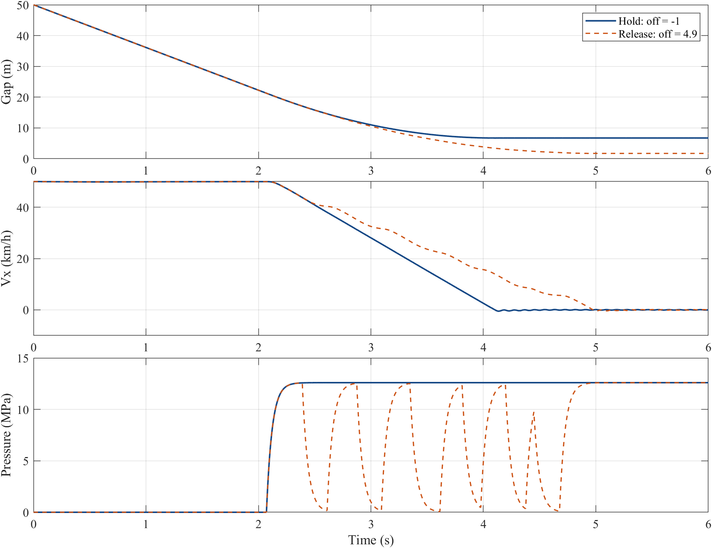

# AI辅助AEB联合仿真 任务组织与结果核验

这是杨竣升的AEB课程项目过程与验证资料仓库，对应论文《AI辅助AEB联合仿真中的任务组织与结果核验》。仓库按任务定义、模型实现、问题定位、对照实验和结果核验组织，保留实现思路及可以重新计算的数值证据。

项目采用CarSim 2024.0与MATLAB/Simulink R2024a。当前有效车辆配置为 **BMW X3 xDrive 25i参数化模型**，由C-Class模板调整而来，部分子系统保留通用部件；不代表完成了X3整车实车标定，也不应称为X5实验。

## 从哪里开始

1. 阅读[项目过程](docs/project_process.md)，了解目标如何变成可验收的任务。
2. 阅读[结果核验](docs/verification.md)，了解每项结论依据哪些通道、对照及误差检查。
3. 阅读[运行与复核说明](docs/reproduce.md)，用已公开的记录重算指标，不需要启动商业仿真软件。
4. 查看[文献复现边界](docs/literature_reproduction.md)，区分接近的结果、未匹配结果和新增假设。
5. 查看[论文与文件对应表](docs/paper_traceability.md)，从图表定位数据及实现。

## 协作流程


## 主要结果

仿真时长为10 s，初始目标坐标为50 m。停车时刻采用首次车速不高于0.5 km/h的定义；间距是50−Xo，不是保险杠净距。

| 工况 | 初速 km/h | 触发时刻 s | 名义停车时刻 s | 最小坐标间距 m | 触发器切换次数 |
|---|---:|---:|---:|---:|---:|
| 保持基线 | 50 | 2.0712 | 4.0825 | 6.7281 | 1 |
| 窄滞环释放对照 | 50 | 2.0712 | 4.9554 | 1.7258 | 12 |
| 初速扰动 | 45 | 2.5927 | 4.4080 | 5.7489 | 1 |
| 初速扰动 | 55 | 1.6185 | 3.8244 | 7.8231 | 1 |

零制动增益对照保留触发与油门切断，10 s时车速约44.1185 km/h、Xo约132.2929 m。它说明压力输入会改变车辆响应，不是整个控制器关闭实验。



## 仓库结构

```text
docs/                    过程、核验方法、复现边界与论文索引
models/                  冻结的Simulink主模型和实验模型
scripts/verify_evidence.py 用记录重算并核对指标
scripts/reproduce_ccrs.py 独立重算文献简化复现
scripts/run_one_case.m    在另行配置的本地环境运行单个实验
scripts/history/         历史实现，仅用于过程追溯
data/cases/              六组完整采样记录及原生通道
data/reproduction/       CCRs简化复现记录
data/model_configuration.json 当前参数与信号约定
results/                 指标汇总、曲线及原始核验报告
skills/                  从本项目提炼的简易协作与核验skill
```

仓库保留100001个采样点的六组Simulink输出和相关原生通道；基线与重复组另提供全部690个通道的无损分块档案，以便复核687个非计时通道完全相同的结论。`data/provenance.json`保存原始CSV哈希；压缩仅改变存储形式，不做下采样或数值修饰。

CarSim求解器、安装文件、商用车辆参数表和期刊PDF不包含在本仓库。重新运行联合仿真需要自行准备相应软件、数据库和本地路径；仅复核公开数值记录不需要这些软件。

## 简易 skill

项目的可复用经验已整理为[aeb-simulation-collaboration](skills/aeb-simulation-collaboration/SKILL.md)。它围绕“任务可验收—接口与参数确实生效—实验能区分解释—结果有证据支持”组织AEB联合仿真，适合后续项目搭建、异常排查或已有数据复核。

skill目录只有主说明和一份按需读取的案例参考，可以整体复制给支持`SKILL.md`的AI工具使用。模型、数据和复核脚本仍在本仓库原位置；新的工况需要重新确认单位、阈值与验收条件。

例如，在已有仓库的工作目录中提出：

> 参考skills/aeb-simulation-collaboration/SKILL.md，检查当前AEB模型是否满足单次停车目标。先核对实际生效的参数和单位，再针对异常选择对照实验，交付可重算的指标和结论边界。

## 论文引用

论文引用固定版本[paper-v1](https://github.com/xiwqb/aeb-ai-collaboration/tree/paper-v1)，避免后续主分支修改影响已引用的证据。引用信息也见`CITATION.cff`。

> 杨竣升. AI辅助AEB联合仿真项目过程与验证资料[EB/OL]. GitHub（paper-v1）. https://github.com/xiwqb/aeb-ai-collaboration/tree/paper-v1.
